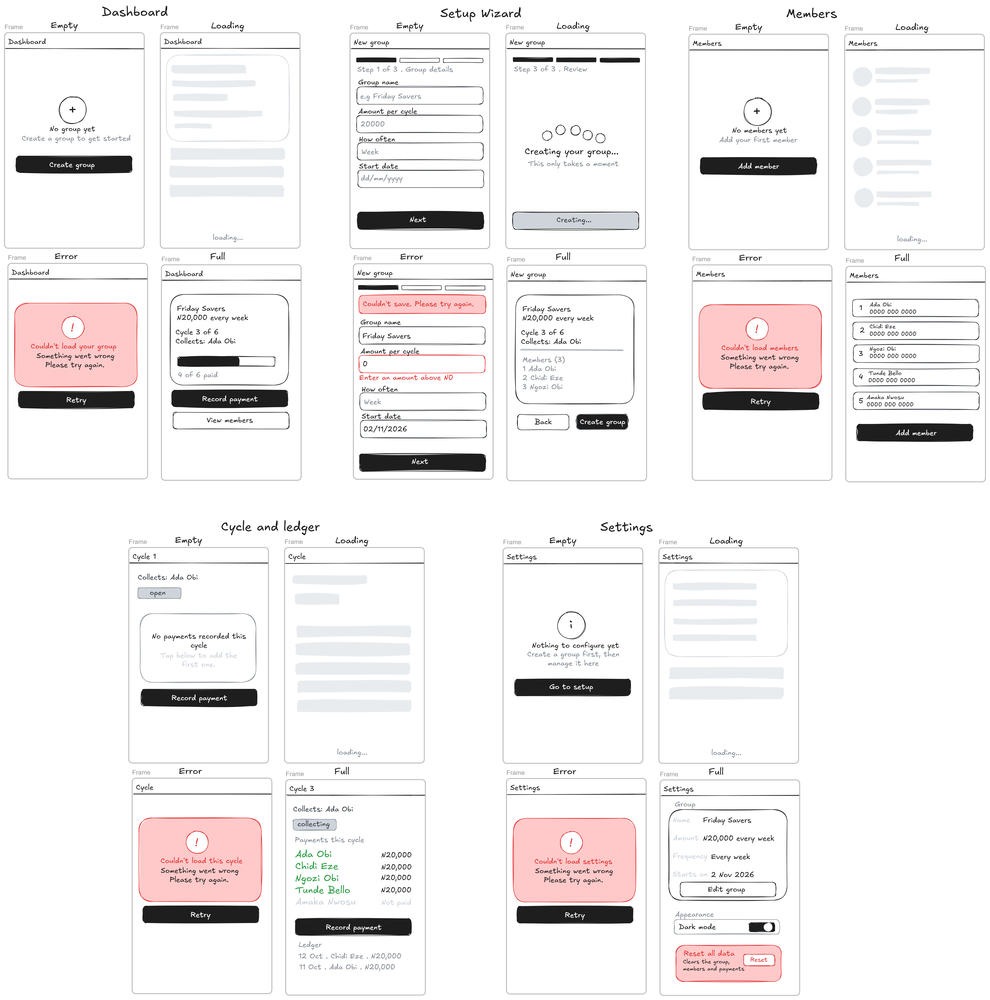

# Ajo Circle

A savings-circle (ajo/esusu) tracker, built as an 8-week pair project with Vue 3. This README covers **Week 1: kickoff and contract**.

## Repo
- Repository: https://github.com/deHypeChief/Ajo-Frontend-Project
- Working branch: [`main`](https://github.com/deHypeChief/Ajo-Frontend-Project/tree/main)

## Partners
| Partner | Role | Responsible for |
|---------|------|-----------------|
| David | **Engine** | Data layer, stores, money helpers, tests, and the data contract in code |
| Kevin | **Surface** | Screens, components, forms, wireframes, and the user interface |

The roles swap in Week 5.

## Stack
- Vue 3 with Vite
- TypeScript
- Pinia (state)
- Vue Router (navigation)
- ESLint and Prettier (code quality)
- No backend: data is kept in the browser (localStorage) behind a simulated server layer

## Project structure
```
src/
  data/      data layer (Engine)
  router/    routes for the five screens
  types/     shared TypeScript types
  views/     one page per screen
  App.vue    navigation and router view
  main.ts    app entry point
docs/
  CONTRACT.md      types and the six data functions
  adr/001.md       decision record
  wireframes/      sketches of the five screens
WORKING-AGREEMENT.md
```

## Week 1 deliverables
- [ ] **Repo link and this README**: names both partners, their roles and the stack (this file)
- [ ] **[Data contract](#data-contract)** ([docs/CONTRACT.md](docs/CONTRACT.md)): every type and the six data function signatures
- [ ] **[Wireframes](#wireframes)** ([docs/wireframes/](docs/wireframes/)): five screens, four states each
- [ ] **[Working agreement](#working-agreement)** ([WORKING-AGREEMENT.md](WORKING-AGREEMENT.md)): branch names, commit style, review turnaround and meeting times
- [ ] **[Decision record](#decision-record)** ([docs/adr/001.md](docs/adr/001.md)): one decision we argued about and how we settled it: derive cycles from the group, members and payments instead of storing them

## Data contract

The full file is [docs/CONTRACT.md](docs/CONTRACT.md). It is reproduced here.

### Contract

Both partners own this file. Changing a type or a function needs both partners to agree.
Code Source of truth: ``src/types/index.ts` and `src/data/contract.ts`.

#### Rules
- Money is `Kobo`: whole numbers only. ₦1,500.50 is `150050`.
- The Surface never imports from `src/data`. It uses the stores only.
- Every data function returns a Promise and can reject.

#### Types

| Type | Field | Type | Written by | read by | Notes |
|---|---|---|---|---|---|
| Member | id | string | data layer | everyone | Assigned by `addMember` |
| Member | name | string | Surface | everyone | Typed in the form |
| Member | phone | string | Surface | Members page | Typed in the form; format validated in M3 |
| Member | position | number | data layer | engine, Members page | 1-based payout slot, unique within the group |
| Group | id | string | data layer | everyone | Assigned by `saveGroup` |
| Group | name | string | Surface | Dashboard, Settings | Typed in the setup wizard |
| Group | amount | kobo | surface | engine, Dashboard | Contribution per member per cycle |
| Group | stratsOn | string | Surface | engine | ISO date `YYYY-MM-DD`; due date of cycle 1  |
| Group | every | Frequency | surface | engine | `'week'`, `'fortnight'` or `'month'` |
| Cycle | n | number | engine | everyone |  1-based cycle number  |
| Cycle | recipientId | string | engine | Cycle page, Payout | The `Member.id` who collects this cycle  |
| Cycle | CycleStaus | Type | engine | Cycle page, Dashboard | See ADR 001: nothing in the six functions writes it yet  |
| Payment| id | string | Sufrace | ledger | Assigned by `recordPayment` |
| Payment| cycle | number | Surface | ledger,engine | The `Cycle.n` this payment belongs to |
| Payment| memberId | string | Surface | ledger,engine | The `Member.id` who paid |
| Payment| paid | Kobo | Surface | engine,ledger | Kobo actually paid. |
| Payment| paidAt | string | data layer | ledger | ISO timestamp is recorded |

#### The six data functions
| Function | Returns | Reads / writes |
|---|---|---|
| `getGroup()` | `Group \| null` | reads group |
| `createGroup(group)` | `Group` | writes group |
| `listMembers()` | `Member[]` | reads members |
| `addMember(input)` | `Member` | writes members |
| `listPayments(cycle?)` | `Payment[]` | reads payments |
| `recordPayment(input)` | `Payment` | writes payments |

## Wireframes

Five screens, four states each (empty, loading, error, full): Dashboard, Setup wizard, Members, Cycle and ledger, and Settings.



## Working agreement

The full file is [WORKING-AGREEMENT.md](WORKING-AGREEMENT.md). It is reproduced here.

### Working Agreement

**Partners:** David (Engine) and Kevin (Surface)
**Repo:** Ajo-Frontend-Project
**Default branch:** `feat/engine-scaffold` (used in place of `main` until the instructor renames it)

We can change this agreement, but only if both of us agree.

#### 1. Branch names
- Nobody pushes directly to the default branch. Every change goes on its own branch and through a pull request.
- Format: `<type>/<short-topic>`, in lowercase with hyphens.
- Types match our commit types: `feat`, `fix`, `docs`, `chore`, `refactor`, `test`.
- Examples: `feat/engine-types`, `feat/surface-wireframes`, `docs/adr-001`.
- One topic per branch. Delete the branch after it is merged.

#### 2. Commit style
Start each message with a type, a colon, and a short description in the present tense.

| Type | Use it for |
|------|-----------|
| `feat:` | a new feature or screen |
| `fix:` | a bug fix |
| `docs:` | documentation, wireframes, logs |
| `chore:` | setup, tooling, config |
| `refactor:` | restructuring code without changing behavior |
| `test:` | adding or changing tests |

Example: `docs: add wireframes for five screens`

- One idea per commit. No messages like "update" or "changes".
- Never commit `node_modules`.

#### 3. Pull requests and review turnaround
- Every change merges through a pull request that the other partner approves. Nobody approves or merges their own PR.
- Reviewers leave at least two specific comments. A bare "LGTM" doesn't count.
- **Review turnaround: within 24 hours** of the PR being opened.
- If there's no review after 24 hours, the author messages the partner. If there's still none after 48 hours, we tell the instructor.
- A PR that changes `docs/CONTRACT.md` needs both of us to agree. A breaking change says so in the PR title.
- Keep PRs small enough to review in about 15 minutes.

#### 4. Meetings
- Two pair sessions a week, 45 minutes each. One drives, one navigates, and we swap halfway.
- Session 1: <day, time, call or in person>
- Session 2: <day, time, call or in person>
- After each session, we add an entry to `docs/PAIR-LOG.md`.

#### 5. Logs
- Every chunk of AI-assisted code or writing goes in `docs/AI-LOG.md`, including what was wrong with it.
- Each milestone, we each file one reproducible bug against the other's work.
- Each milestone, we write one short decision record in `docs/adr/`.

#### 6. If one of us is stuck or unavailable
We message first, then call. If we're still blocked after 48 hours, we ask the instructor.

## Decision record

The full file is [docs/adr/001.md](docs/adr/001.md). It is reproduced here.

### ADR 001: Store cycles or derive them?

Status: DECIDED on 24/10/26

#### Context
A cycle is one round of the savings circle: in round 3, one member collects the pot.
Each cycle has a number, a recipient and a status (`open`, `collecting`, `ready`, `paid`, `closed`).

The six data functions in `CONTRACT.md` can save a group, members and payments.
None of them can save a cycle. So we must decide where cycles come from.

#### Options
1. **Store cycles.** Save each cycle in localStorage. This needs a seventh function, such as `saveCycle`.
   - Good: easy to read back, and a cycle could hold extra notes.
   - Bad: a stored status can disagree with the payments. For example, a cycle says "ready" but a payment is missing.
2. **Derive cycles.** Calculate them each time from the group, the members and the payments.
   - Good: one source of truth, so cycles cannot get out of sync with payments.
   - Bad: some facts cannot be worked out from payments (see Consequences).

#### Decision
Derive cycles. Partner A leans this way because the payments already show who has paid,
so storing the same information a second time creates a chance for the two to disagree.

#### Consequences
- The engine needs a pure function that takes the group, members and payments and returns the list of cycles.
- "Everyone has paid" can be worked out from payments, but "the payout was handed over" cannot,
  because a payout is not a payment. We still need somewhere to record it.
  Plan: decide in M4 whether to add a small stored `payouts` record or a new data function.
- We will not add a seventh function until that problem is settled.

#### What would change our minds
- Calculating cycles becomes too slow for large groups.
- We need to store notes or other data on each cycle.
- The payout problem turns out to need a stored cycle record anyway.

## How we work
- Nobody pushes directly to `main`. Every change goes on its own branch and through a pull request.
- The other partner reviews and approves every pull request before it merges.
- Branch names, commit style and meeting times are in the [working agreement](WORKING-AGREEMENT.md).
- AI-assisted work is logged in `docs/AI-LOG.md`.

## Running the project
```
git clone https://github.com/deHypeChief/Ajo-Frontend-Project.git
cd Ajo-Frontend-Project
npm install
npm run dev
```
Then open the local address it prints (usually http://localhost:5173).